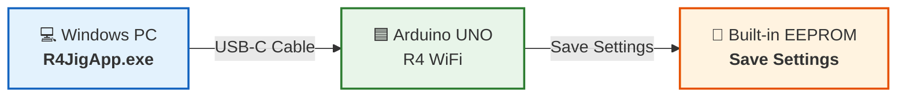
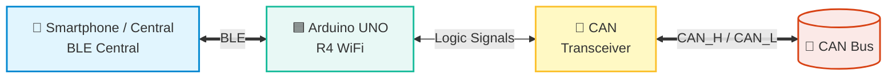
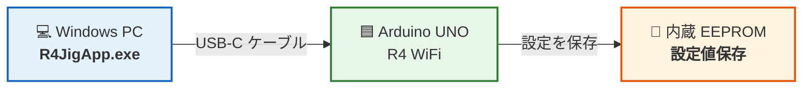
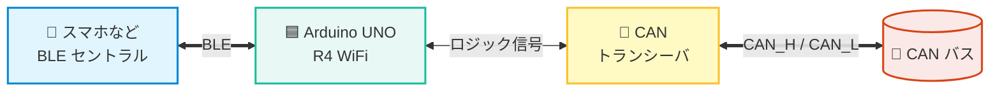

# R4_BleCanBrg

[English](#english) | [日本語](#japanese)

---

## Overview

**R4_BleCanBrg** is a system that bridges bidirectional data between **BLE (Bluetooth Low Energy) and the CAN bus** using an **Arduino UNO R4 WiFi**.  
It consists of the main firmware for Arduino and a Windows PC configuration application (**R4JigApp**) for setting CAN communication parameters (bitrate, TX CAN ID, etc.).

Additionally, this repository bundles a sample peer firmware, **`R4_CanEcho`** **(for Arduino UNO R4 Minima)**, to allow easy communication testing. It echoes (loops back) received CAN messages, making it simple to verify bidirectional communication between BLE and the CAN bus without requiring dedicated CAN analyzers (for details, refer to [CAN Echo Test with Peer Device (R4_CanEcho)](docs/en/manual.md#can-echo-test-with-peer-device-r4_canecho)).

## System Architecture

R4_BleCanBrg operates in two phases: the "Configuration" phase via PC application, and the actual "Bridge Communication" phase.

### 1. Configuration Phase

Use the PC application (R4JigApp) to configure the CAN settings of the Arduino UNO R4 WiFi.

### 2. Bridge Communication Phase

After configuration, the Arduino UNO R4 WiFi bridges bidirectional data between BLE and the CAN bus.

- **BLE → CAN**: Forwards data received from smartphones via BLE to the CAN bus.
- **CAN → BLE**: Forwards data received from the CAN bus to smartphones via BLE.

## BLE Specifications
BLE communication adheres to the **Nordic UART Service (NUS)** (for UUID and details, refer to [BLE Specifications](docs/en/manual.md#ble-specifications-nordic-uart-service)).

## Usage
For setup procedures and usage instructions, please refer to the following documents:
- [R4_BleCanBrg Manual](docs/en/manual.md)
- [Firmware Build and Flashing Guide](docs/en/build-guide.md)

  *Flashing firmware for R4_BleCanBrg and R4_CanEcho is performed using the Arduino IDE.*

## Source Code
Source code for both the firmware and the PC application is included in this repository:
- **Firmware (`src_fw/`)**:
  - `R4_BleCanBrg/`: BLE ⇔ CAN bridge (Main: Arduino UNO R4 WiFi)
  - `R4_CanEcho/`: CAN echo test (Peer: Arduino UNO R4 Minima)
- **PC Application (`src_app/`)**:
  - `JigApp/`: Source code for the PC configuration application (R4JigApp)

## Disclaimer
Shiomachi Software (the author) assumes no liability or responsibility for any troubles, losses, or damages resulting from the use of this software or the implementation of the contents of this repository.

## License
The proprietary implementation portions of this repository are released under the MIT License.  
Dependent libraries and board packages are subject to their respective licenses.

---

## 概要

**R4_BleCanBrg** は、**Arduino UNO R4 WiFi** を使用して、**BLE（Bluetooth Low Energy）とCANバスの間でデータを中継（ブリッジ）** するシステムです。  
Arduino用のファームウェア本体と、Windows PCからCAN通信設定（ボーレートやTX CAN IDなど）を行う設定アプリ（R4JigApp）で構成されています。

また、本リポジトリには手軽に通信テストを実施できるよう、対向機用のサンプルファームウェア **`R4_CanEcho`** **(Arduino UNO R4 Minima 用)** を同梱しています。受信したCANメッセージをそのまま折り返して送信 (エコー) するため、CANアナライザ等が手元にない場合でも、BLEとCANバス間の双方向通信を容易に動作検証できます (詳細は [対向機 (R4_CanEcho) を使用したCANエコーテスト](docs/ja/manual.md#対向機-r4_canecho-を使用したcanエコーテスト) を参照してください)。

## システム構成

R4_BleCanBrgは、PCアプリによる「設定」と、実際の「ブリッジ通信」の2つのフェーズで構成されています。

### 1. 設定時の構成

PCアプリ（R4JigApp）を使用して、Arduino UNO R4 WiFi の CAN通信設定を行います。

### 2. ブリッジ通信時の構成

設定完了後、Arduino UNO R4 WiFiはBLEとCANバスの間で双方向データ中継を行います。

- **BLE → CAN**: スマホ等からBLEで受信したデータをCANバスへ転送します。
- **CAN → BLE**: CANバスから受信したデータをBLEでスマホ等へ転送します。

## BLE 仕様
BLE通信には、汎用的なシリアル通信プロファイルである **Nordic UART Service (NUS)** を使用しています（UUID等の詳細は [BLE仕様](docs/ja/manual.md#ble仕様-nordic-uart-service) を参照してください）。

## 使い方
セットアップ手順や使用方法については、以下のマニュアルをご参照ください。
- [R4_BleCanBrg マニュアル](docs/ja/manual.md)
- [ファームウェアビルド・書き込み方法](docs/ja/build-guide.md)
  
  ※R4_BleCanBrg および R4_CanEcho のファームウェアの書き込みは、Arduino IDE を使用して行います。

## ソースコード
ファームウェアとPCアプリの両方のソースコードを同梱しています。
- **ファームウェア (`src_fw/`)**:
  - `R4_BleCanBrg/`: BLE ⇔ CAN ブリッジ (メイン機: Arduino UNO R4 WiFi)
  - `R4_CanEcho/`: CANエコーテスト用 (対向機: Arduino UNO R4 Minima)
- **PCアプリ (`src_app/`)**:
  - `JigApp/`: 設定用PCアプリケーション（R4JigApp）のソースコード

## 免責事項
本ソフトウェアの使用、または本リポジトリの内容を実施したことにより生じたいかなるトラブル・損失・損害についても、塩町ソフトウェア（作成者）は一切の責任を負いません。

## ライセンス
このプロジェクトのリポジトリに含まれる独自の実装部分は、MITライセンスの下で公開されています。  
依存ライブラリやボードパッケージには個別のライセンスが適用されます。
