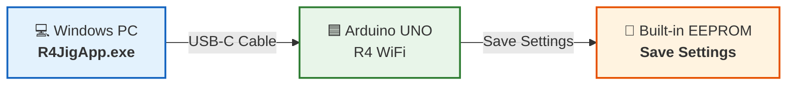
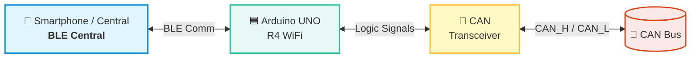
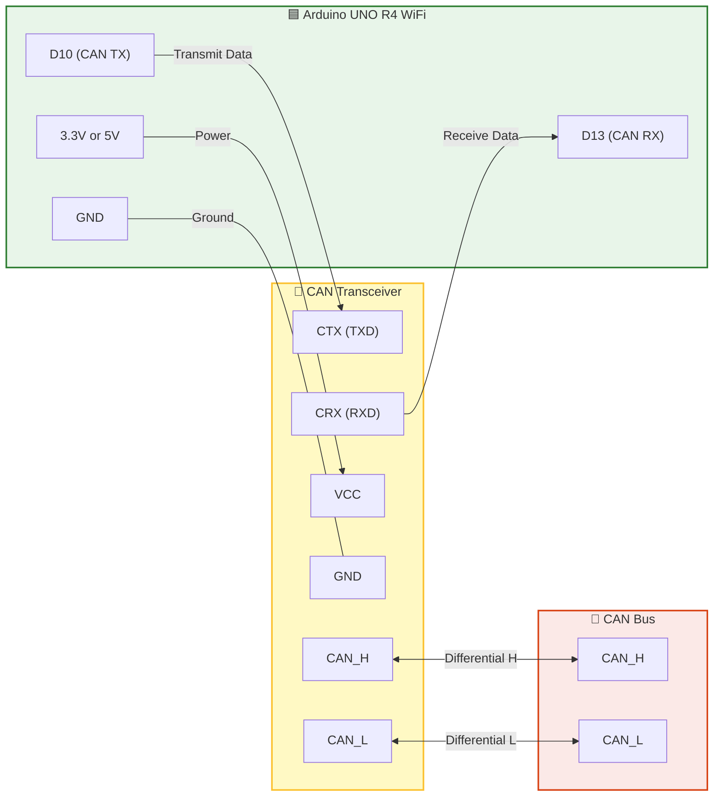
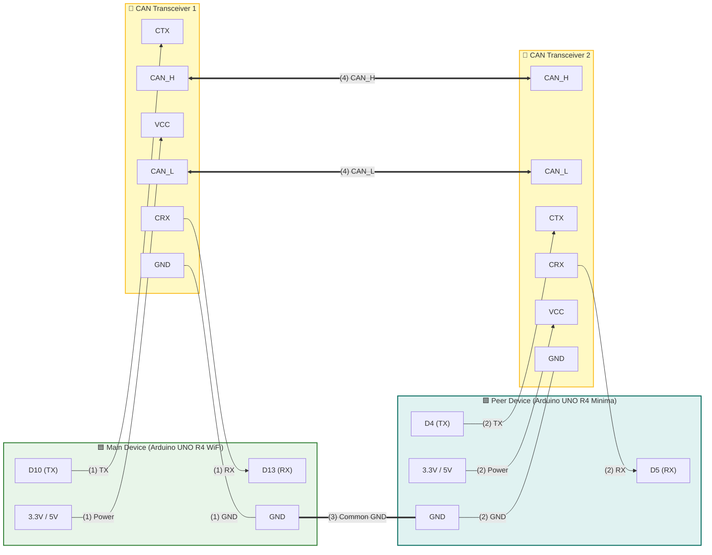

# R4_BleCanBrg Manual

## Table of Contents

- [Disclaimer](#disclaimer)
- [Overview](#overview)
  - [System Architecture](#system-architecture)
- [Hardware Configuration and Wiring](#hardware-configuration-and-wiring)
  - [Pin Assignment](#pin-assignment)
  - [CAN Transceiver Connection](#can-transceiver-connection)
- [Firmware Flashing](#firmware-flashing)
- [LED Matrix Display Specifications](#led-matrix-display-specifications)
- [BLE Specifications (Nordic UART Service)](#ble-specifications-nordic-uart-service)
- [Default Settings](#default-settings)
- [CAN Communication Specifications](#can-communication-specifications)
- [Configuration via PC Application](#configuration-via-pc-application)
  - [System Requirements (Verifying .NET Framework)](#system-requirements-verifying-net-framework)
  - [Launching and Connecting R4JigApp](#launching-and-connecting-r4jigapp)
  - [CAN Configuration](#can-configuration)
  - [Erasing EEPROM Configuration Data](#erasing-eeprom-configuration-data)
  - [Checking and Clearing Firmware Errors](#checking-and-clearing-firmware-errors)
- [Verifying BLE ⇔ CAN Bridge Operation](#verifying-ble--can-bridge-operation)
  - [Connecting via Mobile App (Serial Bluetooth Terminal)](#connecting-via-mobile-app-serial-bluetooth-terminal)
  - [Verifying BLE → CAN Conversion](#verifying-ble--can-conversion)
  - [Verifying CAN → BLE Conversion](#verifying-can--ble-conversion)
- [CAN Echo Test with Peer Device (R4_CanEcho)](#can-echo-test-with-peer-device-r4_canecho)
  - [1. Required Items](#1-required-items)
  - [2. Pin Connection Chart](#2-pin-connection-chart)
  - [3. Default CAN Settings for Both Devices](#3-default-can-settings-for-both-devices)
  - [4. CAN Echo Test Procedure](#4-can-echo-test-procedure)

---

## Disclaimer

Shiomachi Software (the author) assumes no liability or responsibility for any troubles, losses, or damages resulting from the use of this software or the implementation of the contents of this document.

---

## Overview

**R4_BleCanBrg** is a system that bridges bidirectional data between **BLE (Bluetooth Low Energy) and the CAN bus** using an **Arduino UNO R4 WiFi**.  
It consists of the main firmware for Arduino and a Windows PC configuration application (**R4JigApp**) for setting CAN communication parameters.

Additionally, this repository bundles a sample peer firmware, **`R4_CanEcho`** **(for Arduino UNO R4 Minima)**, to allow easy communication testing. It echoes (loops back) received CAN messages, making it simple to verify bidirectional communication between a smartphone and the CAN bus without requiring dedicated CAN analyzers (for details, refer to [CAN Echo Test with Peer Device (R4_CanEcho)](#can-echo-test-with-peer-device-r4_canecho)).

### System Architecture

R4_BleCanBrg operates in two phases: the "Configuration" phase via PC application, and the actual "Bridge Communication" phase.

#### 1. Configuration Phase

Use the PC application (R4JigApp) to configure the CAN settings of the Arduino UNO R4 WiFi.



- Connect the PC and Arduino UNO R4 WiFi using a USB-C cable.
- Configure CAN parameters (bitrate, CAN ID, etc.) from the PC application. Settings are saved to the microcontroller's internal EEPROM.

#### 2. Bridge Communication Phase

After configuration, the Arduino UNO R4 WiFi bridges bidirectional data between BLE and the CAN bus.



- **BLE → CAN**: Forwards data received via BLE from a smartphone or other central device to the CAN bus.
- **CAN → BLE**: Forwards data received from the CAN bus to the smartphone via BLE.

---

## Hardware Configuration and Wiring

### Pin Assignment

The pins used on the Arduino UNO R4 WiFi are as follows:

| Function | Arduino UNO R4 WiFi Pin | Connected To | Remarks |
| :--- | :--- | :--- | :--- |
| **CAN TX** | **D10** | CAN Transceiver TXD / CTX | CAN Transmit Data |
| **CAN RX** | **D13** | CAN Transceiver RXD / CRX | CAN Receive Data |
| **Status Display** | **LED Matrix (12×8)** | Onboard 12×8 LED Matrix | BLE Connection Status Indicator |
| **Power (3.3V / 5V)** | **3.3V or 5V** | CAN Transceiver VCC | Connect either 3.3V or 5V according to your transceiver's rated voltage |
| **GND** | **GND** | CAN Transceiver GND | Power Ground |

### CAN Transceiver Connection

Because the CAN controller signals of the Arduino UNO R4 WiFi (D10/D13) are logic-level signals, an external **CAN transceiver** is required to connect to a physical CAN bus.

> **About CAN Transceiver Supply Voltage:**  
> Commercially available CAN transceivers generally operate at either **3.3V** (e.g., SN65HVD230) or **5V** (e.g., MCP2551, TJA1050).  
> According to your CAN transceiver specifications, connect either the **3.3V or 5V pin** of the Arduino to the VCC of the CAN transceiver.



---

## Firmware Flashing

Flashing firmware to each microcontroller board is performed using the **Arduino IDE**.  
Flash the firmware corresponding to your intended board:

| Firmware | Target Board | Purpose |
| :--- | :--- | :--- |
| **`R4_BleCanBrg`** | **Arduino UNO R4 WiFi** | **Main Device (Required)**: Main unit that bridges BLE ⇔ CAN |
| **`R4_CanEcho`** | **Arduino UNO R4 Minima** | **Peer Device (Optional)**: Used only when running CAN echo tests |

For detailed flashing procedures, please refer to the [Firmware Build and Flashing Guide](build-guide.md).

---

## LED Matrix Display Specifications

The 12×8 LED Matrix on the Arduino UNO R4 WiFi displays the BLE connection status:

```
【BLE Disconnected: Blinking Center Bar】   【BLE Connected: Solid Full Bar】
    . . . . . . . . . . . .               . . . . . . . . . . . .
    . . . . . . . . . . . .               . . . . . . . . . . . .
    . . . . . . . . . . . .               . . . . . . . . . . . .
    . . . . ■ ■ ■ ■ . . . .               ■ ■ ■ ■ ■ ■ ■ ■ ■ ■ ■ ■
    . . . . ■ ■ ■ ■ . . . .               ■ ■ ■ ■ ■ ■ ■ ■ ■ ■ ■ ■
    . . . . . . . . . . . .               . . . . . . . . . . . .
    . . . . . . . . . . . .               . . . . . . . . . . . .
    . . . . . . . . . . . .               . . . . . . . . . . . .
```

- **Disconnected (Advertising)**: The center bar (center 4×2 dots) blinks at 500 ms intervals.
- **BLE Connected**: The full bar (12×2 dots) remains steadily lit.

---

## BLE Specifications (Nordic UART Service)

BLE communication in this system adheres to the **Nordic UART Service (NUS)** defined by Nordic Semiconductor.

- **Device Name**:
  `R4_BleCanBrg`
- **Service UUID**:
  `6E400001-B5A3-F393-E0A9-E50E24DCCA9E`
- **RX Characteristic (BLE → CAN)**:
  `6E400002-B5A3-F393-E0A9-E50E24DCCA9E`
  - Properties: Write / WriteWithoutResponse
  - Forwards data written by central devices (e.g., smartphones) to the CAN bus.
- **TX Characteristic (CAN → BLE)**:
  `6E400003-B5A3-F393-E0A9-E50E24DCCA9E`
  - Properties: Notify
  - Notifies central devices with data received from the CAN bus.

---

## Default Settings

| Parameter | Default Value | Remarks / Range |
| :--- | :--- | :--- |
| **BLE Device Name** | **`R4_BleCanBrg`** | Fixed |
| **CAN Bitrate** | **500 kbps** | 125k, 250k, 500k, 1000k (1M) bps |
| **TX CAN ID** | **`0x100`** | Standard: `0x000` to `0x7FF` / Extended: `0x00000000` to `0x1FFFFFFF` |
| **CAN ID Type** | **Standard (11-bit)** | Standard (11-bit) / Extended (29-bit) |

---

## CAN Communication Specifications

- **Reception Behavior (Transparent Bridge)**:
  - Hardware reception filters and masks are disabled, allowing the unit to **receive frames of all IDs on the CAN bus and bridge them to BLE** (transparent bridge specification).
  - Only the payload (data bytes) of received CAN frames is forwarded via BLE Notify (CAN ID and ID type are not included in BLE packets). Frames with DLC=0 (data length of 0 bytes) are ignored.

- **CAN Bus vs. BLE Throughput Difference, Flow Control, and Packet Dropping**:
  - There is a throughput gap between the CAN bus (up to 1 Mbps) and BLE (NUS).
  - If the bridge buffer queue (FreeRTOS queue: 16 frames in each direction) becomes full, packet dropping occurs to prevent stale packets from lingering, and firmware error flags (`BLE to CAN buffer overflow` or `CAN to BLE buffer overflow`) are set.
  - When transmitting bursts of high-frequency data, ensure appropriate transmit intervals or implement flow control at the application layer.

---

## Configuration via PC Application

The Windows PC application **`R4JigApp`** (`bin/R4JigApp/R4JigApp.exe`) can be used to configure CAN settings and inspect or clear errors for both the main device (**`R4_BleCanBrg`**) and the peer device (**`R4_CanEcho`**).

### System Requirements (Verifying .NET Framework)
- **OS**: Windows 11
- **.NET Framework Version**: .NET Framework 4.6.2 or later
  - On Windows 11, it runs directly with the default .NET Framework 4.8.
  - Unsupported: .NET 5 or higher (incompatible; will not launch).

### Launching and Connecting R4JigApp
1. Connect the target Arduino (UNO R4 WiFi: `R4_BleCanBrg` or UNO R4 Minima: `R4_CanEcho`) to the PC using a USB-C cable.
2. Double-click `bin/R4JigApp/R4JigApp.exe` to launch the application.
3. Select the COM port corresponding to the Arduino from the **[Port]** combo box.
4. Click the **[Connect]** button.
5. Once connected, firmware information (firmware name, version, etc.) will be read from the microcontroller and displayed on the screen.

### CAN Configuration

1. Click the **[CAN]** button on the main window to open the CAN configuration dialog.
2. Configuration Parameters:
   - **Bitrate**: Select the CAN communication bitrate (`125k`, `250k`, `500k`, `1000k` bps).
   - **TX CAN ID**: Enter the CAN ID to attach upon transmission in hexadecimal (Hex).
   - **RX CAN ID** (Displayed only when `R4_CanEcho` is connected): Enter the target CAN ID to receive in hexadecimal (Hex).
   - **ID Type**: Select either `Standard (11-bit)` or `Extended (29-bit)`.
3. Click the **[Write]** button to save the settings to the Arduino's internal EEPROM.
4. After updating settings, the microcontroller will reboot automatically and begin operating with the new configuration.

### Erasing EEPROM Configuration Data
- To restore settings to initial default values, click the **[Erase]** button on the main window.
- When prompted with the confirmation dialog, select "Yes". The CAN configuration in EEPROM will be erased, and the microcontroller will reboot with the default values for each respective board.

### Checking and Clearing Firmware Errors
1. **Checking Errors**:
   - Errors detected by the firmware are displayed in the "FW Error" field on the main window.
   - Main error messages include:
     - `CAN transmission error`: CAN transmit failure (e.g., node disconnected or no ACK returned)
     - `BLE transmission error`: BLE notification failure
     - `CAN initialization error`: Failed to initialize the onboard CAN controller
     - `BLE to CAN buffer overflow`: Buffer queue full for CAN transmission (16 frames)
     - `CAN to BLE buffer overflow`: Buffer queue full for BLE notification (16 frames)
     - `Microcontroller was reset by WDT timeout`: Automatic reset detected due to Watchdog Timer timeout
2. **Clearing Errors**:
   - Clicking the **[Clear]** button next to the FW Error field resets error flags in the firmware and clears the display.

---

## Verifying BLE ⇔ CAN Bridge Operation

### Connecting via Mobile App (Serial Bluetooth Terminal)

#### Preparation
1. Install the "Serial Bluetooth Terminal" app on your Android smartphone.

#### Connection Steps
1. Launch Serial Bluetooth Terminal on your phone.
2. Open the menu and tap **Devices**.
3. Select the **Bluetooth LE** tab.
4. Tap **SCAN**.
5. Select **`R4_BleCanBrg`** to establish a connection.

### Verifying BLE → CAN Conversion
1. Enter and send arbitrary data from Serial Bluetooth Terminal.
2. The Arduino UNO R4 WiFi receives the data and transmits it to the CAN bus using the configured TX CAN ID (data longer than 8 bytes is automatically split into 8-byte chunks and transmitted sequentially).
3. Verify on a CAN analyzer or receiving device that the data has arrived accurately.

### Verifying CAN → BLE Conversion
1. Transmit data to the CAN bus from a peer CAN device.
2. The Arduino UNO R4 WiFi receives the CAN data and forwards it to the smartphone via BLE.
3. Verify that the received data appears on the Serial Bluetooth Terminal screen.

---

## CAN Echo Test with Peer Device (R4_CanEcho)

Even if you do not have a commercial CAN analyzer, you can easily verify bidirectional BLE ⇔ CAN communication (CAN echo test) by connecting two Arduinos using the bundled sample program **`R4_CanEcho`** (`src_fw/R4_CanEcho/`) running on an **Arduino UNO R4 Minima** as a peer device.

### 1. Required Items

List of equipment and parts required to perform the CAN echo test with two Arduinos (`R4_BleCanBrg` and `R4_CanEcho`):

| Item | Quantity | Purpose / Notes |
| :--- | :---: | :--- |
| **Arduino UNO R4 WiFi** | **1 unit** | Main device (runs `R4_BleCanBrg` firmware) |
| **Arduino UNO R4 Minima** | **1 unit** | Peer device (runs `R4_CanEcho` firmware) *Minima only* |
| **CAN Transceiver** | **2 units** | Connected to each Arduino (3.3V or 5V operation) |
| **Jumper Wires (Male-to-Female)** | **8 pcs** | Arduino to CAN transceiver wiring (4 pcs per set × 2 sets) |
| **Jumper Wires (Female-to-Female)** | **2 pcs** | Transceiver-to-transceiver connection (CAN_H, CAN_L) |
| **Jumper Wires (Male-to-Male)** | **1 pc** | Common ground connection between Arduinos |
| **USB-C Cable** | **2 pcs** | Power and connection for each Arduino |
| **Windows PC** | **1 unit** | Runs PC configuration app (R4JigApp) |
| **Smartphone (Android)** | **1 unit** | Runs BLE app (Serial Bluetooth Terminal) for testing |

### 2. Pin Connection Chart

> [!WARNING]
> **The CAN pin assignments differ between the Arduino UNO R4 WiFi and the Arduino UNO R4 Minima.**  
> - **Main Device (Arduino UNO R4 WiFi)**: CAN TX = **D10** / CAN RX = **D13**  
> - **Peer Device (Arduino UNO R4 Minima)**: CAN TX = **D4** / CAN RX = **D5**  

#### Overall Wiring Diagram



#### (1) Connecting Main Device (Arduino UNO R4 WiFi) to CAN Transceiver 1

| Main Device (WiFi) Pin | CAN Transceiver 1 Pin | Jumper Wire | Signal Description / Notes |
| :--- | :--- | :--- | :--- |
| **D10** | **CTX** (or TXD) | Male-to-Female | CAN Transmit Data (TX) |
| **D13** | **CRX** (or RXD) | Male-to-Female | CAN Receive Data (RX) |
| **3.3V or 5V** | **VCC** | Male-to-Female | Supply 3.3V or 5V according to transceiver voltage rating |
| **GND** | **GND** | Male-to-Female | Power Ground |

#### (2) Connecting Peer Device (Arduino UNO R4 Minima) to CAN Transceiver 2

| Peer Device (Minima) Pin | CAN Transceiver 2 Pin | Jumper Wire | Signal Description / Notes |
| :--- | :--- | :--- | :--- |
| **D4** | **CTX** (or TXD) | Male-to-Female | CAN Transmit Data (TX) |
| **D5** | **CRX** (or RXD) | Male-to-Female | CAN Receive Data (RX) |
| **3.3V or 5V** | **VCC** | Male-to-Female | Supply 3.3V or 5V according to transceiver voltage rating |
| **GND** | **GND** | Male-to-Female | Power Ground |

#### (3) Common Ground Connection between Both Arduinos

| Source Pin (Main Device) | Destination Pin (Peer Device) | Jumper Wire | Notes |
| :--- | :--- | :--- | :--- |
| **Arduino UNO R4 WiFi GND** | **Arduino UNO R4 Minima GND** | Male-to-Male | **Common Ground (Required to unify reference potential even when powered separately)** |

#### (4) Connecting CAN Transceiver 1 to CAN Transceiver 2

| CAN Transceiver 1 Pin | CAN Transceiver 2 Pin | Jumper Wire | Notes |
| :--- | :--- | :--- | :--- |
| **CAN_H** | **CAN_H** | Female-to-Female | Differential High Line |
| **CAN_L** | **CAN_L** | Female-to-Female | Differential Low Line |

### 3. Default CAN Settings for Both Devices

The main device (`R4_BleCanBrg`) and peer device (`R4_CanEcho`) are configured by default to communicate with each other out-of-the-box:

| Setting Parameter | Main Device (`R4_BleCanBrg`) | Peer Device (`R4_CanEcho`) |
| :--- | :--- | :--- |
| **CAN Bitrate** | **`500 kbps`** | **`500 kbps`** |
| **TX CAN ID** | **`0x100`** | **`0x101`** |
| **RX CAN ID** | *(Receives all frames)* | **`0x100`** |
| **CAN ID Type** | **Standard (11-bit)** | **Standard (11-bit)** |

### 4. CAN Echo Test Procedure

1. **Power on both units**:
   - Connect USB cables to both the main device (Arduino UNO R4 WiFi: `R4_BleCanBrg`) and the peer device (Arduino UNO R4 Minima: `R4_CanEcho`).
2. **Connect via BLE from Smartphone**:
   - In "Serial Bluetooth Terminal" on Android, connect to **`R4_BleCanBrg`** (for details, refer to [Connecting via Mobile App (Serial Bluetooth Terminal)](#connecting-via-mobile-app-serial-bluetooth-terminal)).
3. **Echo Transmission Test**:
   - Send arbitrary text from **Serial Bluetooth Terminal**.
   - If the echoed data is received from the peer device and displayed on the Serial Bluetooth Terminal screen, the test is successful.
