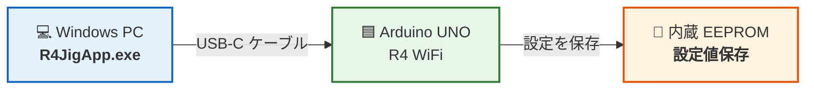
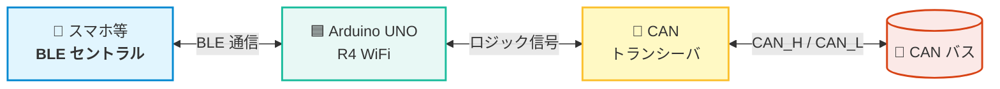
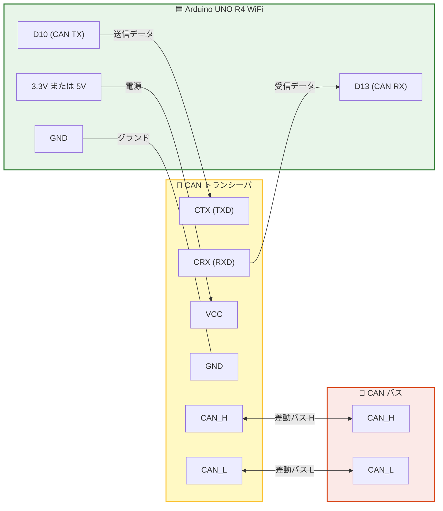
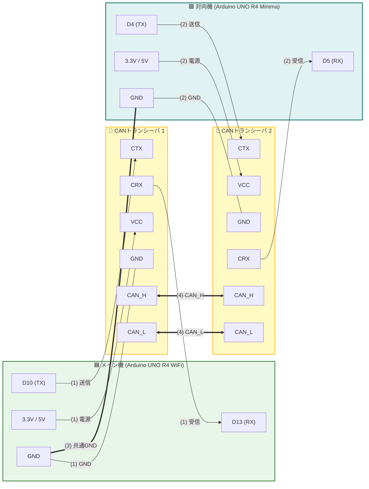

# R4_BleCanBrg マニュアル

## 目次

- [免責事項](#免責事項)
- [概要](#概要)
  - [システム構成](#システム構成)
- [ハードウェア構成と接続](#ハードウェア構成と接続)
  - [使用ピン](#使用ピン)
  - [CANトランシーバの接続](#canトランシーバの接続)
- [ファームウェアの書き込み](#ファームウェアの書き込み)
- [LED Matrix 表示仕様](#led-matrix-表示仕様)
- [BLE仕様 (Nordic UART Service)](#ble仕様-nordic-uart-service)
- [デフォルト設定](#デフォルト設定)
- [CAN通信の仕様](#can通信の仕様)
- [PCアプリを使用した設定](#pcアプリを使用した設定)
  - [動作環境 (.NET Framework の確認)](#動作環境-net-framework-の確認)
  - [R4JigAppの起動と接続](#r4jigappの起動と接続)
  - [CAN設定](#can設定)
  - [EEPROM内設定データの消去](#eeprom内設定データの消去)
  - [ファームウェアエラーの確認とクリア](#ファームウェアエラーの確認とクリア)
- [BLE ⇔ CAN ブリッジ動作の確認](#ble--can-ブリッジ動作の確認)
  - [スマホアプリ (Serial Bluetooth Terminal) の接続手順](#スマホアプリ-serial-bluetooth-terminal-の接続手順)
  - [BLE → CAN 変換の確認](#ble--can-変換の確認)
  - [CAN → BLE 変換の確認](#can--ble-変換の確認)
- [対向機 (R4_CanEcho) を使用したCANエコーテスト](#対向機-r4_canecho-を使用したcanエコーテスト)
  - [1. 必要なもの一覧](#1-必要なもの一覧)
  - [2. ピン接続対応表](#2-ピン接続対応表)
  - [3. 両機のデフォルトCAN設定](#3-両機のデフォルトcan設定)
  - [4. CANエコーテスト手順](#4-canエコーテスト手順)

---

## 免責事項

本ソフトウェアの使用、または本書の内容を実施したことにより生じたいかなるトラブル・損失・損害についても、塩町ソフトウェア (作成者) は一切の責任を負いません。

---

## 概要

**R4_BleCanBrg** は、**Arduino UNO R4 WiFi** を使用して、**BLE (Bluetooth Low Energy) とCANバスの間でデータを中継 (ブリッジ)** するシステムです。  
Arduino用のファームウェア本体と、Windows PCからCAN通信設定を行う設定アプリ (R4JigApp) で構成されています。

また、本リポジトリには手軽に通信テストを実施できるよう、対向機用のサンプルファームウェア **`R4_CanEcho`** **(Arduino UNO R4 Minima 用)** を同梱しています。受信したCANメッセージをそのまま折り返して送信 (エコー) するため、CANアナライザ等が手元にない場合でも、スマートフォンとCANバス間の双方向通信を容易に動作検証できます (詳細は [対向機 (R4_CanEcho) を使用したCANエコーテスト](#対向機-r4_canecho-を使用したcanエコーテスト) を参照してください)。

### システム構成

R4_BleCanBrgは、PCアプリによる「設定」と、実際の「ブリッジ通信」の2つのフェーズで構成されています。

#### 1. 設定時の構成

PCアプリ (R4JigApp) を使用して、Arduino UNO R4 WiFi のCAN設定を行います。



- PCとArduino UNO R4 WiFiをUSBケーブル (Type-C) で接続します。
- PCアプリからCAN設定 (ボーレートやCAN IDなど) を行うことができます。設定値はマイコン内蔵のEEPROMに保存されます。

#### 2. ブリッジ通信時の構成

設定完了後、Arduino UNO R4 WiFiはBLEとCANバスの間で双方向データ中継を行います。



- **BLE → CAN**: スマホ等からBLEで受信したデータをCANバスへ転送します。
- **CAN → BLE**: CANバスから受信したデータをBLEでスマホ等へ転送します。

---

## ハードウェア構成と接続

### 使用ピン

Arduino UNO R4 WiFi で使用するピンは以下の通りです。

| 機能 | Arduino UNO R4 WiFi ピン | 接続先 | 備考 |
| :--- | :--- | :--- | :--- |
| **CAN TX** | **D10** | CANトランシーバの TXD / CTX | CAN送信データ |
| **CAN RX** | **D13** | CANトランシーバの RXD / CRX | CAN受信データ |
| **ステータス表示** | **LED Matrix (12×8)** | オンボード 12×8 LEDマトリクス | BLE接続状態表示 |
| **電源 (3.3V / 5V)** | **3.3V または 5V** | CANトランシーバの VCC | CANトランシーバの定格電圧 (3.3V / 5V) に合わせてどちらか一方を接続 |
| **GND** | **GND** | CANトランシーバの GND | 電源グランド |

### CANトランシーバの接続

Arduino UNO R4 WiFi の CAN コントローラ信号 (D10/D13) はロジックレベル信号のため、物理CANバスへ接続するには **CANトランシーバ** が必要です。

> **CANトランシーバの電源電圧について:**  
> 市販されているCANトランシーバには **3.3V動作** (SN65HVD230等) と **5V動作** (MCP2551、TJA1050等) の2種類があります。  
> ご使用になるCANトランシーバの仕様 (定格電圧) に合わせて、Arduino側の **3.3V または 5V ピンのどちらか一方** を選んで CANトランシーバの VCC に接続してください。



---

## ファームウェアの書き込み

各マイコンボードへのファームウェアの書き込みは、**Arduino IDE** を使用して行います。  
用途に合わせて、対象のArduinoボードにファームウェアを書き込んでください。

| ファームウェア | 対象ボード | 用途 |
| :--- | :--- | :--- |
| **`R4_BleCanBrg`** | **Arduino UNO R4 WiFi** | **メイン機 (必須)**: BLE ⇔ CAN ブリッジを行う本体 |
| **`R4_CanEcho`** | **Arduino UNO R4 Minima** | **対向機 (任意)**: CANエコーテストを行う場合のみ使用 |

書き込み手順については、[ファームウェアビルド・書き込み方法](build-guide.md) を参照してください。

---

## LED Matrix 表示仕様

Arduino UNO R4 WiFi の 12×8 LEDマトリクスに、BLEの接続状態が表示されます。

```
【BLE未接続時: センターバー点滅】       【BLE接続中: フルバー常時点灯】
    . . . . . . . . . . . .               . . . . . . . . . . . .
    . . . . . . . . . . . .               . . . . . . . . . . . .
    . . . . . . . . . . . .               . . . . . . . . . . . .
    . . . . ■ ■ ■ ■ . . . .               ■ ■ ■ ■ ■ ■ ■ ■ ■ ■ ■ ■
    . . . . ■ ■ ■ ■ . . . .               ■ ■ ■ ■ ■ ■ ■ ■ ■ ■ ■ ■
    . . . . . . . . . . . .               . . . . . . . . . . . .
    . . . . . . . . . . . .               . . . . . . . . . . . .
    . . . . . . . . . . . .               . . . . . . . . . . . .
```

- **未接続 (アドバタイズ中)**: 中央のセンターバー (中央 4×2 ドット) が 500ms 間隔で点滅します。
- **BLE接続中**: 横一線のフルバー (12×2 ドット) が常時点灯します。

---

## BLE仕様 (Nordic UART Service)

本システムのBLE通信は、Nordic Semiconductor社が策定した **Nordic UART Service (NUS)** に準拠しています。

- **デバイス名**:
  `R4_BleCanBrg`
- **サービスUUID**:
  `6E400001-B5A3-F393-E0A9-E50E24DCCA9E`
- **RX Characteristic (BLE → CAN)**:
  `6E400002-B5A3-F393-E0A9-E50E24DCCA9E`
  - プロパティ: Write / WriteWithoutResponse
  - スマホ等のセントラルから送信されたデータをCANバスへ転送します。
- **TX Characteristic (CAN → BLE)**:
  `6E400003-B5A3-F393-E0A9-E50E24DCCA9E`
  - プロパティ: Notify
  - CANバスから受信したデータをNotifyとしてスマホ等へ通知します。

---

## デフォルト設定

| 設定項目 | デフォルト値 | 備考・範囲 |
| :--- | :--- | :--- |
| **BLEデバイス名** | **`R4_BleCanBrg`** | 固定 |
| **CANボーレート** | **500 kbps** | 125k, 250k, 500k, 1000k (1M) bps |
| **TX CAN ID** | **`0x100`** | 標準: `0x000` ～ `0x7FF` / 拡張: `0x00000000` ～ `0x1FFFFFFF` |
| **CAN IDタイプ** | **Standard (11-bit)** | Standard (11-bit) / Extended (29-bit) |

---

## CAN通信の仕様

- **受信動作 (透過ブリッジ)**:
  - ハードウェア受信フィルタおよびマスクは設定されておらず、**CANバス上の全IDのフレームを受信してBLEへ中継**します (透過ブリッジ仕様)。
  - 受信したCANフレームのデータ部 (ペイロード) のみがBLE Notifyとして転送されます (CAN IDやIDタイプはBLEデータに含まれません)。また、DLC=0 (データ長0バイト) のフレームは転送対象外となります。

- **CANバスとBLEのスループット差・フロー制御とパケット破棄について**:
  - CANバス (最大1Mbps) とBLE (NUS) では通信速度やスループットに差があります。
  - ブリッジ用バッファキューが満杯になった場合、古いパケットの滞留を防ぐためパケット破棄が発生し、FWエラーフラグ (`BLE to CAN buffer overflow` または `CAN to BLE buffer overflow`) がセットされます。
  - 高頻度・大量の連続送信を行う場合は、送信間隔を適切に設けるか、アプリケーション側でフロー制御を行ってください。

---

## PCアプリを使用した設定

Windows PC用設定アプリ **`R4JigApp`** (`bin/R4JigApp/R4JigApp.exe`) を使用して、メイン機 (**`R4_BleCanBrg`**) および対向機 (**`R4_CanEcho`**) のCAN設定を変更できます。

### 動作環境 (.NET Framework の確認)
- **OS**: Windows 11
- **.Net FrameWorkのバージョン**： .NET Framework 4.6.2以降
  Windows 11では、標準の .NET Framework 4.8 でそのまま動作します。
  非対応： .NET 5 以上（互換性がないため動作しません）

### R4JigAppの起動と接続
1. 設定対象の Arduino (UNO R4 WiFi: `R4_BleCanBrg`、または UNO R4 Minima: `R4_CanEcho`) を USB-C ケーブルで PC に接続します。
2. `bin/R4JigApp/R4JigApp.exe` をダブルクリックして起動します。
3. **[Port]** コンボボックスから Arduino の COM ポートを選択します。
4. **[Connect]** ボタンをクリックします。
5. 正常に接続されると、マイコンからファームウェア情報 (ファームウェア名、バージョンなど) が読み出され、画面上に表示されます。

### CAN設定

1. メイン画面の **[CAN]** ボタンをクリックすると、CAN設定ウィンドウが開きます。
2. 設定項目:
   - **Bitrate**: CAN通信ボーレートを選択します (`125k`, `250k`, `500k`, `1000k` bps)。
   - **TX CAN ID**: 送信時に付与するCAN IDを16進数 (Hex) で指定します。
   - **RX CAN ID** (`R4_CanEcho` 接続時のみ表示): 受信対象とするCAN IDを16進数 (Hex) で指定します。
   - **ID Type**: `Standard (11-bit)` または `Extended (29-bit)` を選択します。
3. **[Write]** (保存) ボタンをクリックすると、設定値が Arduino の内蔵 EEPROM に書き込まれます。
4. 設定変更後は、マイコンが自動再起動して新しい設定値で動作を開始します。

### EEPROM内設定データの消去
- 設定値を初期値に戻したい場合は、メイン画面の **[Erase]** ボタンをクリックします。
- 確認ダイアログで「はい」を選択すると、EEPROM内のCAN設定データが消去され、マイコンが再起動して各マイコンの初期値に戻ります。

### ファームウェアエラーの確認とクリア
1. **エラーの確認**:
   - メイン画面の「FW Error」欄に、ファームウェア内で検知されたエラーが表示されます。
   - 表示される主なエラー内容:
     - `CAN transmission error`: CAN送信エラー (相手ノード未接続、またはACKが返ってこない場合など)
     - `BLE transmission error`: BLE送信エラー (送信失敗など)
     - `CAN initialization error`: CAN初期化エラー (マイコン内蔵CANコントローラの初期化失敗など)
     - `BLE to CAN buffer overflow`: BLEから受信したデータのCAN送信待ちキュー (16フレーム) 溢れ
     - `CAN to BLE buffer overflow`: CANから受信したデータのBLE通知待ちキュー (16フレーム) 溢れ
     - `Microcontroller was reset by WDT timeout`: WDTタイムアウトによるマイコン自動リセット検知 (フリーズからの復旧通知)
2. **エラーのクリア**:
   - FW Error欄の横にある **[Clear]** ボタンを押すと、ファームウェア内のエラー情報がリセットされ、表示がクリアされます。

---

## BLE ⇔ CAN ブリッジ動作の確認

### スマホアプリ (Serial Bluetooth Terminal) の接続手順

#### 事前準備
1. Androidスマホに、「Serial Bluetooth Terminal」のアプリをインストールします。

#### 接続手順
1. スマホ上でSerial Bluetooth Terminalを起動します。
2. メニューから「Devices」を押します。
3. 「Bluetooth LE」タブを押します。
4. 「SCAN」を押します。
5. `R4_BleCanBrg` を押して接続します。

### BLE → CAN 変換の確認
1. Serial Bluetooth Terminal から送信したいデータを入力して送信します。
2. Arduino UNO R4 WiFi がデータを受信し、設定されたTX CAN IDでCANバスへ送信します (8バイトを超える長いデータは、自動的に8バイト単位に分割して順次送信されます)。
3. CANアナライザや対向機器で、データが正しく届いていることを確認します。

### CAN → BLE 変換の確認
1. 対向のCAN機器からCANバスへデータを送信します。
2. Arduino UNO R4 WiFi がCANデータを受信し、スマホ (BLE) へ転送します。
3. Serial Bluetooth Terminal の画面に、受信したデータが表示されることを確認します。

---

## 対向機 (R4_CanEcho) を使用したCANエコーテスト

市販のCANアナライザをお持ちでない場合でも、対向機として **Arduino UNO R4 Minima** を使用したサンプルプログラム **`R4_CanEcho`** (`src_fw/R4_CanEcho/`) を用いることで、Arduino 2台を接続してBLE ⇔ CANの通信 (CANエコーテスト) を簡単に検証できます。  

### 1. 必要なもの一覧

Arduino 2台 (`R4_BleCanBrg` と `R4_CanEcho`) を接続してCANエコーテストを行うために必要な機材・部品の一覧です。

| 品名 | 数量 | 用途・備考 |
| :--- | :---: | :--- |
| **Arduino UNO R4 WiFi** | **1台** | メイン機 (`R4_BleCanBrg` ファームウェアを実行) |
| **Arduino UNO R4 Minima** | **1台** | 対向機 (`R4_CanEcho` ファームウェアを実行) ※Minima専用 |
| **CANトランシーバ** | **2個** | 各Arduinoに1個接続 (3.3V または 5V 動作) |
| **ジャンパワイヤ (オス - メス)** | **8本** | Arduino ⇔ CANトランシーバ間の配線用 (Arduino側オス / トランシーバ側メス、各4本 × 2組) |
| **ジャンパワイヤ (メス - メス)** | **2本** | CANトランシーバ同士の接続用 (CAN_H, CAN_L) |
| **ジャンパワイヤ (オス - オス)** | **1本** | Arduino同士の共通GND接続用 (別電源動作時に必須、基準電位統一用) |
| **USB-C ケーブル** | **2本** | 各Arduinoの給電・接続用 |
| **Windows PC** | **1台** | PCアプリ (R4JigApp) を実行 (メイン機接続用) |
| **スマートフォン (Android)** | **1台** | BLEアプリ (Serial Bluetooth Terminal) から通信テストを行う端末 |

### 2. ピン接続対応表

> [!WARNING]
> **Arduino UNO R4 WiFi と Arduino UNO R4 Minima では、CAN端子のピン番号が異なります**。  
> - **メイン機 (Arduino UNO R4 WiFi)**: CAN TX = **D10** / CAN RX = **D13**  
> - **対向機 (Arduino UNO R4 Minima)**: CAN TX = **D4** / CAN RX = **D5**  

#### 接続全体図



#### (1) メイン機 (Arduino UNO R4 WiFi) と CANトランシーバ1 の接続

| メイン機 (WiFi) 端子 | CANトランシーバ1 端子 | 使用ワイヤ | 信号内容・備考 |
| :--- | :--- | :--- | :--- |
| **D10** | **CTX** (または TXD) | オス - メス | CAN送信データ (TX) |
| **D13** | **CRX** (または RXD) | オス - メス | CAN受信データ (RX) |
| **3.3V または 5V** | **VCC** | オス - メス | トランシーバの定格電圧に合わせて3.3Vまたは5Vを給電 |
| **GND** | **GND** | オス - メス | 電源グランド |

#### (2) 対向機 (Arduino UNO R4 Minima) と CANトランシーバ2 の接続

| 対向機 (Minima) 端子 | CANトランシーバ2 端子 | 使用ワイヤ | 信号内容・備考 |
| :--- | :--- | :--- | :--- |
| **D4** | **CTX** (または TXD) | オス - メス | CAN送信データ (TX) |
| **D5** | **CRX** (または RXD) | オス - メス | CAN受信データ (RX) |
| **3.3V または 5V** | **VCC** | オス - メス | トランシーバの定格電圧に合わせて3.3Vまたは5Vを給電 |
| **GND** | **GND** | オス - メス | 電源グランド |

#### (3) メイン機 と 対向機 のGND接続

| 接続元 (メイン機端子) | 接続先 (対向機端子) | 使用ワイヤ | 備考 |
| :--- | :--- | :--- | :--- |
| **Arduino UNO R4 WiFi の GND** | **Arduino UNO R4 Minima の GND** | オス - オス | **共通GND (別電源動作時でも基準電位を統一するため必須接続)** |

#### (4) CANトランシーバ1 と CANトランシーバ2 の接続

| CANトランシーバ1 端子 | CANトランシーバ2 端子 | 使用ワイヤ | 備考 |
| :--- | :--- | :--- | :--- |
| **CAN_H** | **CAN_H** | メス - メス | 差動バス High 信号 |
| **CAN_L** | **CAN_L** | メス - メス | 差動バス Low 信号 |

### 3. 両機のデフォルトCAN設定

メイン機 (`R4_BleCanBrg`) と対向機 (`R4_CanEcho`) は、デフォルト設定のままで往復通信ができるよう設定されています。  

| 設定項目 | メイン機 (`R4_BleCanBrg`) | 対向機 (`R4_CanEcho`) |
| :--- | :--- | :--- |
| **CANボーレート** | **`500 kbps`** | **`500 kbps`** |
| **TX CAN ID** | **`0x100`** | **`0x101`** | 
| **RX CAN ID** | (全フレーム受信) | **`0x100`** | 
| **CAN IDタイプ** | **Standard (11-bit)** | **Standard (11-bit)** | 

### 4. CANエコーテスト手順

1. **両機の電源を投入**:
   - メイン機 (Arduino UNO R4 WiFi: `R4_BleCanBrg`)、対向機 (Arduino UNO R4 Minima: `R4_CanEcho`) それぞれにUSBケーブルを接続して電源を入れます。
2. **スマホからBLE接続**:
   - Androidスマホの「Serial Bluetooth Terminal」から **`R4_BleCanBrg`** に接続します (詳細は [スマホアプリ (Serial Bluetooth Terminal) の接続手順](#スマホアプリ-serial-bluetooth-terminal-の接続手順) を参照してください)。
3. **エコー送受信テスト**:
   - **Serial Bluetooth Terminal** から任意のデータを送信します。
   - 対向機から折り返されたデータを受信し、Serial Bluetooth Terminal の画面に送信したデータがそのまま表示 (エコーバック) されれば成功です。
